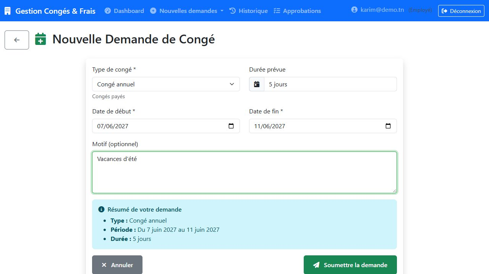
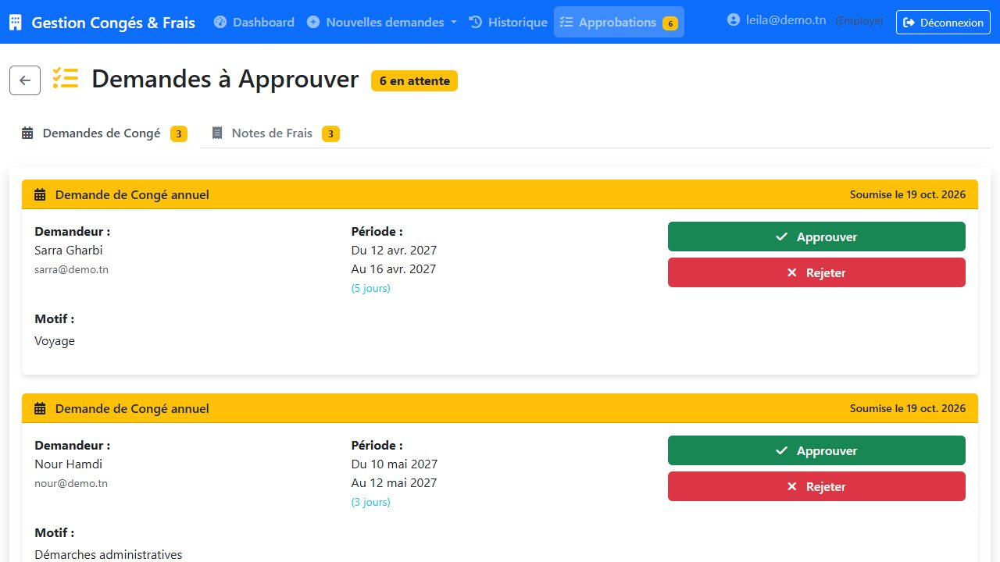
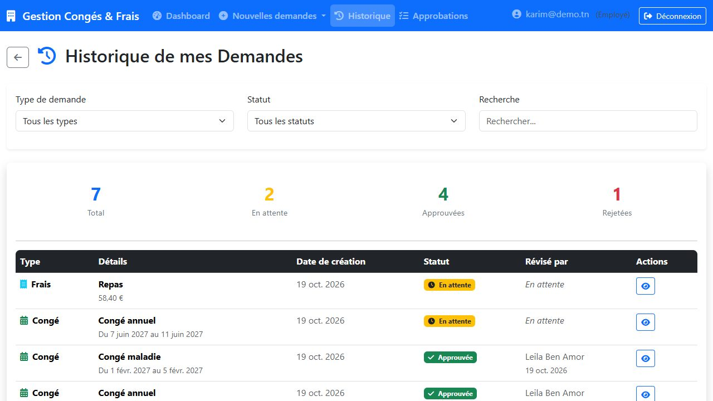
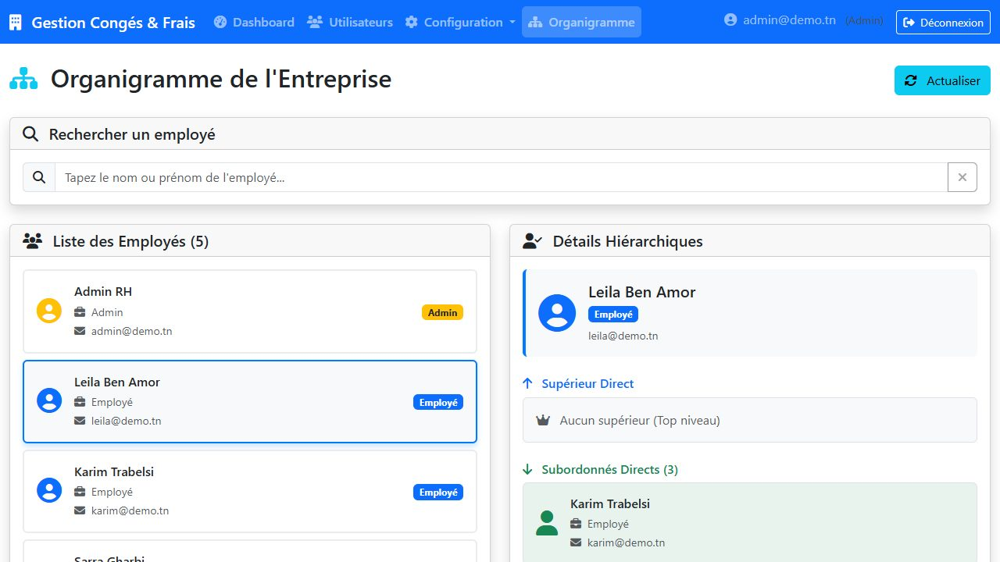

# Gestion des congés et des notes de frais

Application web full-stack de gestion des **demandes de congé** et des **notes de frais**,
avec un circuit de **validation hiérarchique** (employé → manager direct) et un espace
d'administration.

Réalisée pendant mon stage chez **NEOLedge MEA** (juillet 2025).

▶️ **[Voir la vidéo de démonstration (1 min 25)](docs/demo.mp4)**

| Demande de congé | Validation par la manager |
|---|---|
|  |  |

| Historique de l'employé | Organigramme |
|---|---|
|  |  |

## Fonctionnalités

**Employé**
- Demande de congé (type, dates, motif) avec calcul de la durée
- Note de frais (type, montant, description)
- Tableau de bord et historique des demandes, avec le statut et le nom du validateur

**Manager** (tout employé qui a des subordonnés)
- Liste des demandes en attente de **ses subordonnés directs**
- Approbation ou rejet, historique de ses décisions avec statistiques et filtres

**Administrateur**
- Gestion des utilisateurs et de la hiérarchie (manager de chaque employé)
- Types de congés (avec nombre de jours maximum par an), types de frais, jours fériés
- Organigramme avec recherche, supérieur direct et subordonnés

**Règles métier contrôlées par l'API**
- Date de fin postérieure à la date de début, montant strictement positif
- Pas de congé sur un jour férié ni en chevauchement avec un congé déjà approuvé
- Solde annuel par type de congé (`MaxDays`, 0 = illimité)
- Seul le manager direct (ou un admin) peut valider une demande, une seule fois
- Mot de passe temporaire à changer obligatoirement à la première connexion

## Architecture

```
frontend/  Vue.js 3 (Vite, Pinia, Vue Router, Bootstrap 5, Axios)
   │  HTTP + JWT (Authorization: Bearer …)
   ▼
backend/   ASP.NET Core 8 Web API
           Controllers → Services → Entity Framework Core → SQL Server
```

- **Authentification** : JWT, mots de passe hachés (PBKDF2 via `PasswordHasher` d'ASP.NET Identity)
- **Autorisation** : rôles `Admin` / `Employé` (`[Authorize(Roles = "Admin")]`) et règle
  hiérarchique « manager direct » pour les validations
- **Base de données** : migrations EF Core appliquées automatiquement au démarrage
- **Documentation de l'API** : Swagger (`/swagger` en développement)

## Lancer le projet en local

**Prérequis** : [.NET 8 SDK](https://dotnet.microsoft.com/download/dotnet/8.0),
Node.js 18+, SQL Server (Express suffit, instance `localhost\SQLEXPRESS`).

1. **Back-end** — la base `GestionCongeFraisDB` est créée au premier lancement :
   ```bash
   cd backend/GestionCongeFrais
   dotnet run --launch-profile http
   ```
   API sur http://localhost:5000, Swagger sur http://localhost:5000/swagger

2. **Front-end** :
   ```bash
   cd frontend
   npm install
   npm run dev
   ```
   Application sur http://localhost:3000

3. Se connecter dans l'**Espace Administrateur** avec le compte créé automatiquement :
   `admin@entreprise.com` / `Admin123!` (un nouveau mot de passe est demandé à la
   première connexion). Créer ensuite les types de congés et de frais, puis les
   employés en leur attribuant un manager.

## Configuration

| Paramètre | Où | Par défaut |
|---|---|---|
| Chaîne de connexion SQL Server | `ConnectionStrings:DefaultConnection` (`appsettings.json`) | `localhost\SQLEXPRESS`, base `GestionCongeFraisDB` |
| Clé de signature JWT | `Jwt:Key` — `appsettings.Development.json` en local, variable d'environnement `Jwt__Key` en production | clé de développement |
| URL de l'API côté front | `VITE_API_URL` (voir `frontend/.env.example`) | `http://localhost:5000/api` |

## Structure

```
backend/GestionCongeFrais/
├── Controllers/   Auth, Users, LeaveRequests, ExpenseRequests, LeaveTypes, ExpenseTypes, Holiday
├── Services/      Logique métier (validation, soldes, hiérarchie)
├── Models/        Entités EF Core
├── DTOs/          Objets d'entrée / sortie de l'API
└── Data/          AppDbContext et migrations
frontend/src/
├── views/admin/      Tableau de bord, utilisateurs, configuration, organigramme
├── views/employee/   Demandes, historique, approbations, décisions
├── services/api.js   Client Axios (token JWT ajouté automatiquement)
└── stores/auth.js    État d'authentification (Pinia)
```
